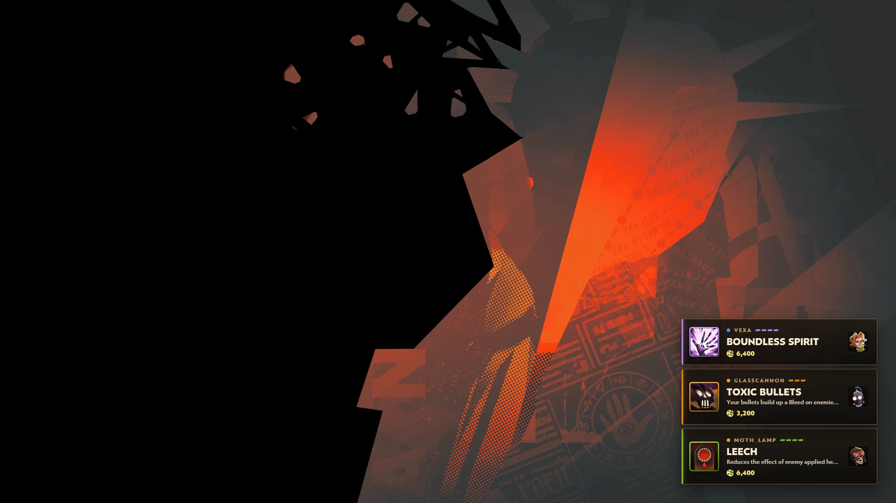
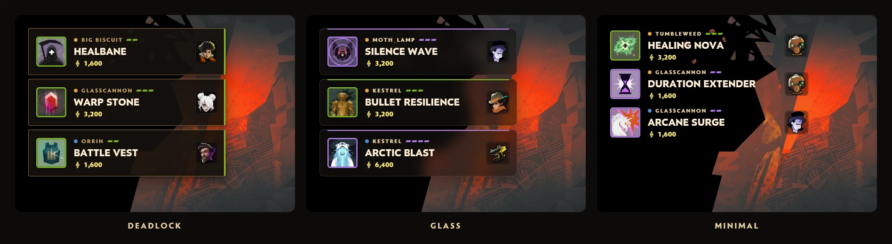
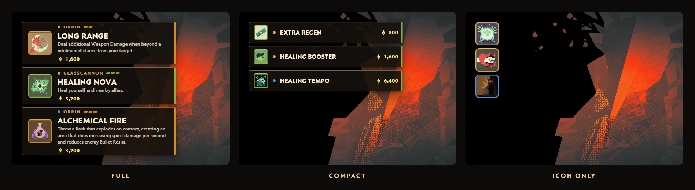
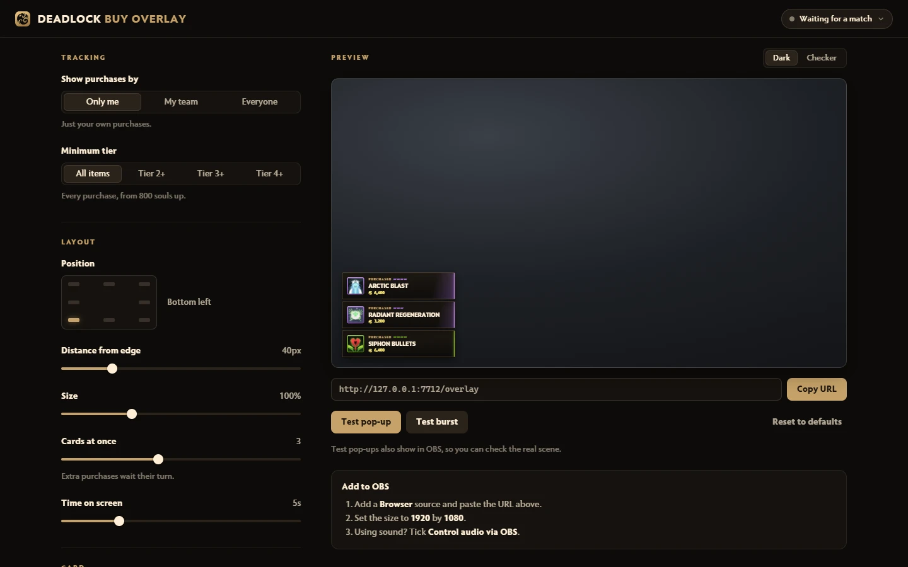
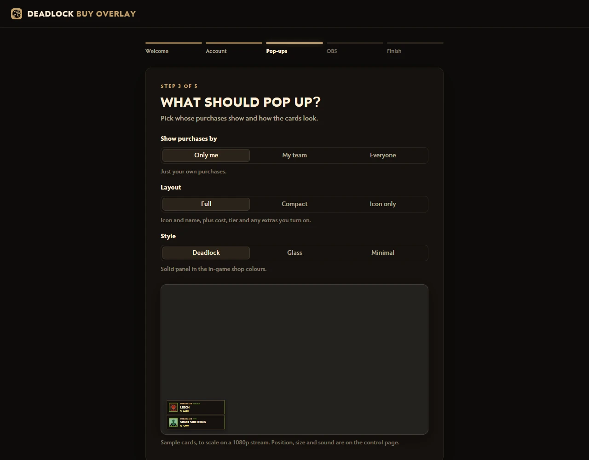

# OBSlock - Deadlock OBS Overlays

Pop-up cards on your stream whenever an item is bought in Deadlock. Show only your own purchases, your team's, or everyone's.

A fan-made tool with no connection to Valve. See [Not affiliated with Valve](#not-affiliated-with-valve).

Pick a style, where the cards sit, how long they stay, and what they show:

Use a full card, one slim line, or just the item icon, with square, rounded, pill or angled corners:

| Control page | First-run setup |
| --- | --- |
|  |  |

## Install

1. Download the zip from the [latest release](https://github.com/negativeblueprint/deadlock-buy-overlay-releases/releases/latest).
2. Extract it anywhere, for example your Documents folder.
3. Double-click `Start.cmd`. If Windows says it protected your PC, click **More info**, then **Run anyway**.
4. A browser tab opens and walks you through setup, including adding the overlay to OBS. You add the link once, and later changes on the control page show up in OBS by themselves.
5. In Steam, right-click Deadlock, choose **Properties**, and add `-condebug` under **Launch Options**. That lets the overlay find your match. Setup shows a green tick once it is set.

If Node.js is not installed, `Start.cmd` installs it for you. New versions show an **Update now** button in the overlay's control page, so you only download once.

## Instant pop-ups

The zip also holds an optional mod, `mod/buy_overlay_bridge.vpk`. It reads the shop's Recent Purchases list, so cards appear within a second of the purchase, in every match. The control page then says **Live from the game**.

It needs mods turned on through a mod manager such as Deadlock Mod Manager. To install it, click the status pill at the top of the control page and then **Install bridge mod**, and restart Deadlock. The button finds the folder Deadlock really loads mods from, which with Deadlock Mod Manager is its profile folder, not `addons` itself. The mod only reads, and nothing on screen changes.

## Good to know

Without the mod, cards come from the match's spectator broadcast, so they appear a few seconds to tens of seconds after the purchase. Valve does not broadcast every match; when it skips yours, the control page tells you.

This repo only holds the downloads.

## Not affiliated with Valve

OBSlock is a fan-made tool. It is not made, endorsed or supported by Valve Corporation, and it has no connection to Valve. Deadlock, its item, hero and souls artwork, and the Deadlock name are trademarks or copyrighted works of Valve Corporation, used here only to show what was bought.
